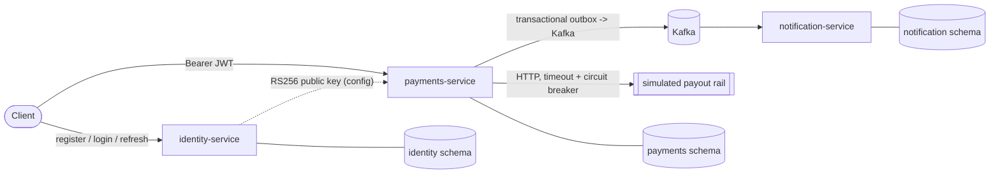
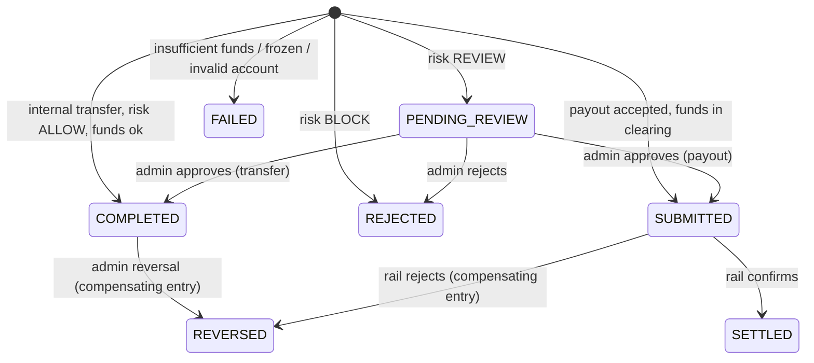

# Architecture

Describes the design that the code implements. The truthful per-feature status lives in `FEATURE_MATRIX.md`;
where this document describes something not yet built it says so.

## 1. Service boundaries

| Service | Responsibility | Why it is separate |
|---|---|---|
| identity-service | users, credentials, refresh tokens, token issuance | holds the signing key and password hashes; different security profile from the money path |
| payments-service | accounts, journal, payments, payouts, risk, idempotency, outbox, reconciliation, audit | **everything that must change atomically lives in one database transaction**; splitting it would need distributed transactions for the core invariant |
| notification-service | consumes payment events, builds user-facing notifications, dead-letter store | a genuine asynchronous consumer: demonstrates inbox idempotency, bounded retries, DLT and replay |

There is deliberately **no API gateway**. Services verify tokens themselves (asymmetric key, no shared secret) and
apply their own rate limits. A production deployment puts an ingress/WAF in front; that is infrastructure, not application code.
There is **no Redis**: nothing in the design needs a cache or shared counters that PostgreSQL cannot do correctly.

Services never read each other's tables. Each uses its own PostgreSQL schema and its own database role.

## 2. Money model

- Amounts are `BIGINT` **minor units** with an ISO-4217 currency; `Money` rejects values with more precision than the currency allows, negative values and overflow. No floating point anywhere.
- **Double entry.** `journal_entries` has many `postings`; each posting is a DEBIT or CREDIT of a positive amount against one account.
  Every entry must have debits = credits per currency. Enforced by a **deferred constraint trigger** at commit, not only in Java.
- **Sign convention.** `balance = Σcredits − Σdebits` for every account. Customer accounts are liabilities of the platform (credit-normal).
  System accounts may go negative (the funding source is negative by exactly the money issued). Consequence: for each currency, Σ balance over all accounts = 0. This is a checkable global invariant.
- `accounts.balance_minor` is a **projection** updated in the same transaction as the postings, guarded by `CHECK (balance_minor >= 0)` for customer accounts.
  The ledger is the source of truth; reconciliation recomputes and compares.
- **Immutability.** `UPDATE`/`DELETE`/`TRUNCATE` on `journal_entries` and `postings` raise an exception (trigger), and the runtime DB role has no such privileges.
  Corrections are new `REVERSAL` entries pointing at the original entry.

### Account types

| Type | Owner | May go negative | Purpose |
|---|---|---|---|
| CUSTOMER | user | no | user wallet |
| FUNDING_SOURCE | system | yes | counter-account for sandbox top-ups |
| PAYOUT_CLEARING | system | yes (never expected) | holds money in flight to the external rail |
| EXTERNAL_SETTLED | system | yes | money confirmed delivered off-platform |

### Journal entry kinds

| Kind | Postings | When |
|---|---|---|
| FUNDING | DR funding_source / CR customer | admin sandbox top-up |
| TRANSFER | DR payer / CR payee | internal transfer completes (settled at once, inside the same DB transaction) |
| PAYOUT_SUBMIT | DR customer / CR payout_clearing | payout accepted for the rail (**not** settled) |
| PAYOUT_SETTLE | DR payout_clearing / CR external_settled | rail confirmed |
| PAYOUT_RETURN | DR payout_clearing / CR customer | rail rejected: compensating entry |
| REVERSAL | exact opposite postings of the referenced TRANSFER entry | admin reversal of a completed transfer |

`UNIQUE (payment_id, kind)` makes each financial effect happen at most once per payment, even if application code is retried or raced.

## 3. Payment state machine

Terminal: `FAILED`, `REJECTED`, `REVERSED`, `SETTLED`. The transition table is code (`PaymentStatus.canTransitionTo`), tests enumerate all pairs,
and every transition is applied with a compare-and-set (`UPDATE ... WHERE status = :expected`) so concurrent actors cannot both win.
Each transition is appended to `payment_status_history` (actor, reason, correlation id).

Business failures (`FAILED`, `REJECTED`) are **committed outcomes bound to the idempotency key**: a retry returns the same answer.
Infrastructure errors roll back everything including the idempotency record, so a retry is a clean re-execution.

## 4. Concurrency and idempotency

Transfer algorithm (single transaction, READ COMMITTED):

1. `INSERT INTO idempotency_keys ... ON CONFLICT DO NOTHING`. If it conflicts, PostgreSQL has already waited for the other transaction; then compare request fingerprints: equal -> return stored payment, different -> 422.
2. Lock both accounts with `SELECT ... FOR UPDATE ORDER BY id` (global lock order -> no deadlocks between opposing transfers).
3. Validate status, currency, funds. Evaluate risk rules (payer is locked, so velocity/limits cannot be raced).
4. Insert payment, journal entry and postings, update both balances (`CHECK` is the last line of defence), append history, insert outbox event. Commit.

No remote call happens inside this transaction.

## 5. Payout flow (external rail, simulated)

1. Transaction A: as above, but posts `PAYOUT_SUBMIT`; payment `SUBMITTED`; outbox `payment.submitted`.
2. After commit, a worker picks up `SUBMITTED` payouts (`FOR UPDATE SKIP LOCKED`, `next_attempt_at`), calls the rail with `Idempotency-Key = paymentId`, a timeout, bounded retries with backoff, behind a circuit breaker.
3. Rail confirms -> Transaction B: `SUBMITTED -> SETTLED` (CAS) + `PAYOUT_SETTLE`. Rail rejects -> Transaction C: `SUBMITTED -> REVERSED` + `PAYOUT_RETURN`.
4. Rail unreachable / breaker open -> payout stays `SUBMITTED`, `attempts` and `next_attempt_at` advance. Past the deadline reconciliation flags it. It is never presumed settled.

The rail in this repository is a **sandbox simulator** (`SimulatedRailClient`) with controllable behaviour for tests. It does not move real money.

## 6. Messaging guarantees

- PostgreSQL and Kafka do not share a transaction. The outbox row is committed atomically with the state change; a relay publishes it afterwards.
- **Producer side: at-least-once, ordered per relay pass.** The relay holds a PostgreSQL advisory lock (single active publisher), publishes in outbox-id order and waits for broker acknowledgement before marking `PUBLISHED`.
  A crash between acknowledgement and marking causes a duplicate publish; that is expected and handled by consumers.
- Failures set `attempts`, `last_error` and an exponential `next_attempt_at`; after the attempt limit the event becomes `DEAD` (alerted via metric, requeued by an admin). Order is preserved per aggregate by `sequence`, not by position.
- **Consumer side: effectively-once effects** via an inbox table (`event_id` unique) in the same transaction as the effect. Delivery itself is at-least-once.
- Consumers tolerate out-of-order events using the per-payment `sequence`.
- Kafka outage: payments still succeed (outbox absorbs it); lag is visible in metrics. PostgreSQL outage: payments fail fast with 503; nothing is acknowledged that was not committed.

## 7. Security architecture

- RS256 access tokens (10 min), `iss`/`aud` validated, roles claim mapped to authorities. Private key only in identity-service.
- Opaque refresh tokens (256-bit random), stored as SHA-256 hash, rotated on use with family reuse detection.
- BCrypt (cost 12) for passwords; constant-time dummy hash for unknown users; temporary lockout on repeated failures.
- Resource-level authorization in payments-service: account and payment reads require ownership (or ADMIN); not-owned -> 404.
- Admin operations require `ROLE_ADMIN` and write to the audit log.
- Per-instance token-bucket rate limits (IP for unauthenticated, user for authenticated).
- Errors use RFC 9457 problem details with stable codes and the correlation id; no stack traces or SQL.
- DB roles: `*_migrator` owns the schema; `*_app` has DML only (and no UPDATE/DELETE on ledger tables).

## 8. Observability

JSON logs (Spring Boot structured logging) with `correlationId`; Micrometer metrics scraped at `/actuator/prometheus` (payments by outcome, outbox backlog/dead, reconciliation findings, breaker state, rate-limit rejections);
`/actuator/health/liveness` and `/readiness`. Distributed tracing is **not** implemented.
